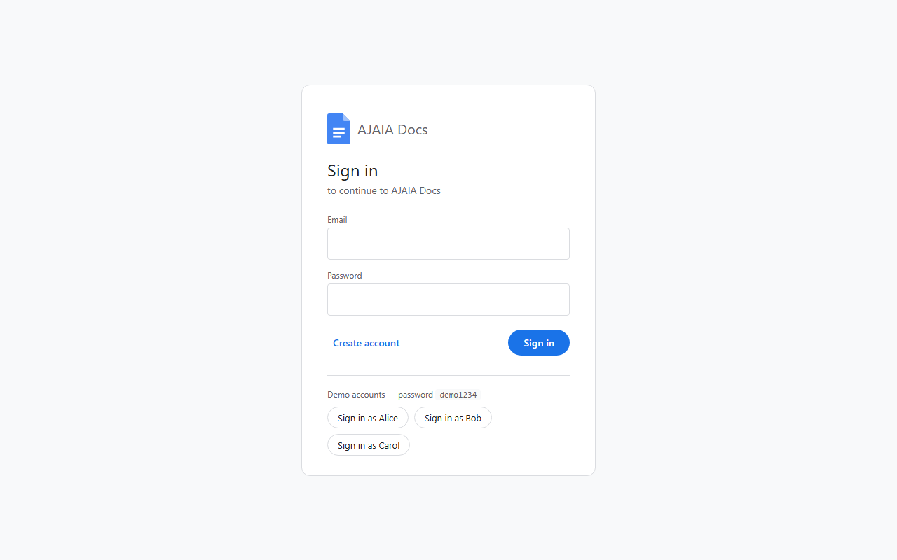

# AJAIA Docs

A lightweight, Google Docs–style document editor: create and format documents in the browser, import files, and share documents with other users.

**Live demo:** https://ajaia-docs.onrender.com _(free tier — the first load after ~15 min idle takes ~30–50 s while the server wakes up)_

**Demo accounts** (password for all: `demo1234`): `alice@demo.com`, `bob@demo.com`, `carol@demo.com` — one-click buttons are on the login page. You can also create your own account.



## Features

| Area | What you can do |
|---|---|
| Documents | Create, rename (click the title), edit, delete. Autosaves ~1 s after you stop typing ("Saving… / All changes saved"). |
| Rich text | Bold, italic, underline, strikethrough, Normal text / Heading 1–3, bulleted & numbered lists, undo/redo, standard shortcuts (Ctrl+B/I/U/Z/Y). |
| File import | Upload **.txt, .md or .docx** (max 5 MB) → becomes a new editable document. Markdown and Word formatting (headings, bold, lists…) is preserved. Other file types are rejected. |
| Sharing | The owner shares by email as **Editor** (can edit content) or **Viewer** (read-only), can change role or revoke. The list has **All / Owned by me / Shared with me** filters and "Can edit / View only" badges; the editor shows who owns a shared doc. |
| Persistence | Postgres. Documents, formatting (stored as sanitized HTML) and shares survive refresh and restarts. |

Permission rules: **Owner** – everything; **Editor** – read and edit content; **Viewer** – read only. Only the owner can rename, share or delete.

## Run locally

Requirements: **Node.js 20+** (tested on Node 22 and 24). No database install needed — locally the app uses [PGlite](https://pglite.dev) (Postgres compiled to WebAssembly) and stores data in `./.data/`.

```bash
npm install
npm run dev          # API on http://localhost:3000 + web UI on http://localhost:5173 (open this one)
```

Production-style run (single server serving API + built UI):

```bash
npm run build
npm start            # http://localhost:3000
```

Tests (API integration tests against an in-memory Postgres):

```bash
npm test
npx vitest run -t "viewer can read"   # run a single test by name
```

### Environment variables (all optional locally)

| Name | Purpose |
|---|---|
| `PORT` | HTTP port (default 3000) |
| `DATABASE_URL` | Postgres connection string. If unset, the embedded PGlite database is used. |
| `JWT_SECRET` | Session signing secret. **Required in production**; locally a random one is generated per run (you'll be logged out when the server restarts). |

## Deploy (Render, free)

The repo contains a [`render.yaml`](render.yaml) Blueprint that creates a free web service and a free Postgres database and wires them together (`DATABASE_URL` and a generated `JWT_SECRET`).

1. Sign in to [render.com](https://render.com) with GitHub.
2. **New → Blueprint** → pick this repository → **Apply**.
3. Wait for the build (~3–5 min). Tables and demo users are created automatically on first start.

Note: Render's free Postgres expires 30 days after creation; free web services sleep after 15 min idle.

## Project layout

```
server/   Express API (auth, documents, sharing, import), DB layer, tests
client/   React + Vite + TipTap single-page app
docs/     Screenshots
```

See [ARCHITECTURE.md](ARCHITECTURE.md) for design decisions, and [AI_WORKFLOW.md](AI_WORKFLOW.md) for how AI was used to build this.
